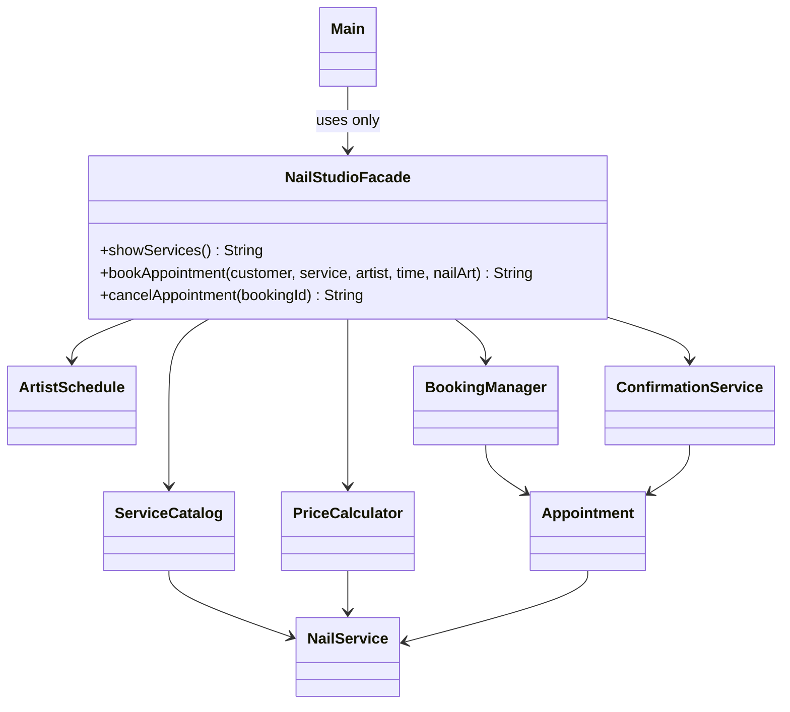

# Blush Nail Studio — Facade Design Pattern

Individual Software Design Patterns assignment (#4), Java implementation.

## Overview

This console application lets customers view nail services, book an appointment with a nail artist, optionally add nail art, and cancel an existing appointment. The `Main` client only communicates with `NailStudioFacade`; it never instantiates or directly calls subsystem classes.

The topic must be confirmed as unique within the class before submitting.

## Requirements

Java 8 or newer. No external dependencies or frameworks.

## Run in IntelliJ IDEA

1. Open the `Blush-Nail-Studio` folder as a project.
2. Configure an installed JDK in **Project Structure** if IntelliJ asks.
3. Open `src/Main.java` and click the green **Run** triangle next to `main`.
4. Use the console menu to book and cancel appointments.

If the IDE does not recognize the source folder, right-click `src` > **Mark Directory as** > **Sources Root**.

## Run from Terminal

From the project folder, on macOS, Linux or Windows PowerShell (with a JDK installed):

```sh
javac -d out src/*.java tests/*.java
java -cp out Main
```

To run automated checks:

```sh
java -cp out NailStudioTest
```

**Windows CMD:**

```bat
javac -d out src\*.java tests\*.java
java -cp out Main
java -cp out NailStudioTest
```

## Example appointment

- Customer: Aigerim
- Service: `gel` (8,000 KZT)
- Artist: `Anna`
- Time: `14:00`
- Nail art: `yes` (+2,000 KZT)
- Total: 10,000 KZT

Booked slots stay reserved until canceled. Two artists may have different appointments at the same time. All data is stored in memory, so restarting the program clears bookings. This is a classroom demo, not a production booking service. Available time slots: 10:00, 12:00, 14:00, 16:00.

## Architecture



### Responsibilities

1. **ServiceCatalog** registers and looks up nail services and their base prices.
2. **ArtistSchedule** validates artists and time slots, and reserves/releases them.
3. **PriceCalculator** computes the base price plus optional nail art.
4. **BookingManager** creates, identifies, looks up, and cancels bookings.
5. **ConfirmationService** builds booking/cancellation messages.
6. **NailStudioFacade** invokes these independent classes in the correct order.
7. **Main** is the client, using only the facade's methods.

The subsystems do not reference or know about `NailStudioFacade`. Their public methods are available to advanced clients who need low-level access.

## Clean Code principles: five justifications

1. **Meaningful names:** `bookAppointment`, `reserve`, `calculateTotal`, `cancelBooking` communicate their purpose.
2. **Single Responsibility Principle:** each subsystem handles only its own domain concern; the facade coordinates.
3. **Simplified public API / information hiding:** `Main` deals only in customer-friendly inputs and messages, not with `Appointment` or `NailService` instances.
4. **Small and focused methods:** validation, price calculation, booking creation and confirmation are separated.
5. **Proper error handling:** invalid inputs and duplicate bookings fail with informative exceptions; the facade rolls back a reserved slot if a later booking step fails.

## Why Facade (not Adapter)?

A Facade **simplifies** the use of several collaborating classes; an Adapter **converts** an incompatible interface into a compatible one. Here, the facade replaces several steps with one high-level `bookAppointment` call.

## Demonstration / defense

1. Explain the roles of Main, Facade, and the five subsystem classes.
2. Explain call order: validate input -> find service -> check slot -> calculate price -> reserve -> create booking -> confirm.
3. Run a successful booking, then try to book the same artist/time (the second attempt must fail).
4. Cancel the initial appointment; retry booking that time (it must succeed).
5. Point to the five Clean Code examples above.

## Scope

- In-memory only: data resets after exiting the program.
- No GUI, database, external payment provider, or date selection is required by this assignment.
- The extra nail art price is 2,000 KZT.
